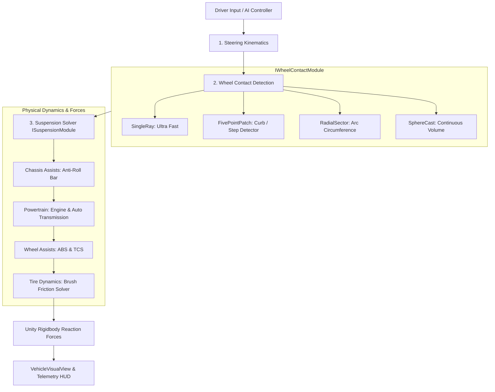

<div align="center">

# 🚗 VALYR

### Modular High-Performance Vehicle Physics & Simulation Framework for Unity

[](https://unity.com/)
[](https://github.com/semantic-release/semantic-release)
[](https://conventionalcommits.org)
[](https://l0nnes.github.io/VALYR/)
[](LICENSE)
[](CONTRIBUTING.md)

<p align="center">
  <b>VALYR</b> is a production-ready, physically grounded simcade and arcade vehicle framework for Unity 6+.<br>
  Engineered with strict separation of concerns, pluggable C# subsystems, multi-ray curb detection, and equilibrium-preloaded suspension dynamics.
</p>

[📖 Read the Documentation](https://l0nnes.github.io/VALYR/) • [🚀 Quick Start](#-quick-start) • [🧩 Architecture](#-architecture--pipeline) • [📦 Semantic Release](#-automated-release--versioning)

</div>

---

## 🌟 Key Features

* **🧩 100% Pure Modular Subsystems (`[SerializeReference]`)**:
  Swap collision scanners, suspension solvers, steering models, transmissions, engines, and tire friction models dynamically in the Inspector without modifying a single line of vehicle code.
* **🎯 5-Point Multi-Ray Contact Patch**:
  Eliminates the ubiquitous needle-ray glitch where wheels pass through curbs. Scans forward profile and tire width to detect curbs, ramps, ruts, and road banking smoothly before the wheel center arrives.
* **🛡️ Zero Wheel-Arch Clipping & Preload Equilibrium**:
  Physical damper lengths (`MinLength`, `TargetLength`, `MaxLength`) measured from top-of-arch anchors. Spring naturally balances corner static weight at `TargetLength`, while hard bump stops guarantee tires never clip into fenders.
* **🏎️ Analytical Brush Tire Friction Model**:
  True combined longitudinal slip ratio ($s_x$) and lateral slip angle ($s_y$) mechanics with progressive friction saturation, weight-transfer sensitivity, and realistic sliding transitions.
* **🎛️ ScriptableObject Preset Ecosystem (`VehiclePreset`)**:
  Save, duplicate, and apply vehicle configurations (Sedan, Sport, Offroad, Drift) in one click with zero asset bloat.
* **👁️ Decoupled Visual Presentation (`VehicleVisualView`)**:
  Keeps tire contact patches 100% flush with the ground (0 sinking, 0 hovering) and smooths visual rotation and compression independently of physics tick rates.
* **📊 In-Game Telemetry HUD (`[F1]`)**:
  Full diagnostic telemetry overlay displaying live damper travel, loads ($F_z$), slip ratios, wheel RPM, and 3D tire traction vectors.

---

## 🧩 Architecture & Pipeline

VALYR executes each discrete physics tick through a strictly deterministic, unidirectional simulation pipeline:



### Subsystems Breakdown

| Subsystem | Contract | Default Implementation | Core Responsibility |
|---|---|---|---|
| **Wheel Contact** | `IWheelContactModule` | `WheelContactModule` | Scans terrain geometry, steps, ruts, road camber, and computes effective damper clearance distances. |
| **Suspension** | `ISuspensionModule` | `RaycastSuspensionModule` | Preload static equilibrium, asymmetric bump/rebound dampers, progressive bump stops, and normal loads ($F_z$). |
| **Steering** | `ISteeringModule` | `DirectSteeringModule` | Speed-sensitive steering attenuation, Ackermann geometry, and rack response damping. |
| **Powertrain** | `IEngineModule` & `ITransmissionModule` | `ArcadeEngineModule`, `SimpleTransmissionModule` | Torque curve evaluation, flywheel inertia, rev limiter, torque converter launch, and auto-shifting. |
| **Tires** | `ITireModule` | `BrushTireModule` | Analytical brush friction mechanics, combined slip ($s_x, s_y$), and grip saturation. |
| **Assists** | `IChassisAssistModule`, `IWheelAssistModule` | `AntiRollBarModule`, `AbsModule`, `TcsModule` | Anti-roll weight transfer, anti-lock brake pulsation, and traction control slip regulation. |

---

## 🚀 Quick Start

### 1. Requirements & Installation
* **Unity 6000.0+ (Unity 6+)**
* **Unity Input System (`com.unity.inputsystem`)**

Clone into your project's `Assets` directory:
```bash
git clone https://github.com/l0nnes/VALYR.git Assets/VALYR
```

### 2. Hierarchy Setup
Create or prepare your vehicle GameObject hierarchy:

```text
Erebus (Rigidbody, VehicleController, VehicleInputReader, VehicleVisualView)
 ├── Meshes/ (Chassis mesh, lights, interior)
 ├── Wheels/Meshes/ (Visual wheel meshes)
 │    ├── FrontLeftWheel
 │    ├── FrontRightWheel
 │    ├── RearLeftWheel
 │    └── RearRightWheel
 ├── Suspension/ (Anchor transforms positioned at ceiling of each wheel arch)
 │    ├── FL_Suspension
 │    ├── FR_Suspension
 │    ├── RL_Suspension
 │    └── RR_Suspension
 └── Colliders/ (Chassis body BoxCollider)
```

> [!TIP]
> **Suspension Anchor Placement**: Place the anchor Transforms directly at the **ceiling of the wheel arches**. All suspension measurements (`MinLength`, `TargetLength`, `MaxLength`) are measured downward from these anchors.

### 3. Inspector Configuration
1. Select your vehicle GameObject.
2. In the `VehicleController` inspector:
   * **Preset**: Assign `Assets/Settings/Sedan_Baseline.asset` and click **"Apply Preset to Vehicle"**.
   * **Wheel Mounts**: Drag your 4 suspension anchor transforms (`FL_Suspension`, etc.) or click **Auto Find**.
   * Set `ChassisMass = 1180 kg` and `WheelRadius = 0.31 m`.
3. Press **Play** in Unity, drive using `W/A/S/D` or Arrow keys, and press **[F1]** to inspect real-time physics telemetry.

---

## 📐 Suspension Kinematics & Math

```
[ Suspension Anchor (FL_Suspension) ] --- Top of Wheel Arch
               │
               │  <-- Arch clearance gap: MinLength - WheelRadius >= 2 cm
               ▼
[ MinLength (0.33m) ]  --- Hard Bump Stop Limit (Zero Arch Clipping)
               │
               │  <-- Bump Travel (5 cm)
               ▼
[ TargetLength (0.38m) ] --- Equilibrium Ride Height (Nominal Rest Position)
               │
               │  <-- Rebound Travel (17 cm)
               ▼
[ MaxLength (0.55m) ]  --- Droop Limit in Air (Airborne)
```

* **Hooke's Spring with Static Preload**:
  $$F_{\text{spring}} = m_{\text{corner}} \cdot g + k \cdot (\text{TargetLength} - L)$$
* **Profile-Compensated Multi-Ray Contact**:
  $$L_k = d_k - \sqrt{\max(0, R^2 - x_k^2)}$$
  $$L_{\text{effective}} = \min_k (L_k)$$

---

## 📦 Automated Release & Versioning

VALYR utilizes **Semantic Release** with **Conventional Commits**:

| Commit Type | SemVer Bump | Description |
|---|---|---|
| `feat:` | **MINOR** (`0.X.0`) | New modular subsystem, contact algorithm, or visual feature. |
| `fix:` | **PATCH** (`0.0.X`) | Bug fix, suspension damping tuning, or collider correction. |
| `perf:` | **PATCH** (`0.0.X`) | Performance optimization or allocation reduction. |
| `docs:` | None / Patch | Documentation update or VitePress guide improvement. |
| `BREAKING CHANGE:` | **MAJOR** (`X.0.0`) | Breaking changes to core module interfaces. |

On every push to `master` / `main`:
1. GitHub Actions runs `@semantic-release/commit-analyzer`.
2. Generates updated `CHANGELOG.md` and bumps `package.json`.
3. Publishes a GitHub Release with tagged releases (`vX.Y.Z`).
4. Rebuilds and deploys the VitePress documentation site to **GitHub Pages**.

---

## 📚 Documentation Site

Run the local VitePress documentation server:
```bash
npm install
npm run docs:dev
```

Build production static documentation:
```bash
npm run docs:build
```

---

## 📄 License

VALYR is licensed under the [MIT License](LICENSE).
Contributions, feedback, and pull requests are warmly welcomed!
