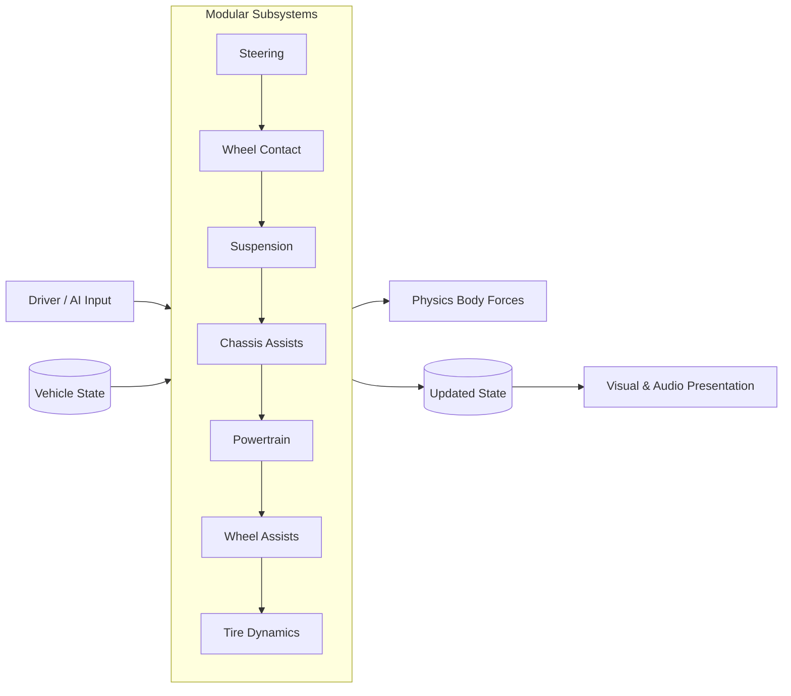

<div align="center">

# VALYR

### Modular, state-driven vehicle framework for Unity

[](https://unity.com/)
[](LICENSE)

</div>

VALYR is a modular vehicle physics and simulation framework for Unity built entirely around **deterministic state pipelines**.

Instead of mixing physics math, input handling, and visual logic into heavy monolithic components, VALYR structures vehicle simulation as a clean, unidirectional sequence of state transformations: `(State, Input) ➔ Pipeline ➔ (New State, Forces)`.

Because the entire simulation state is held in lightweight, explicit data structures, adding multiplayer with client-side prediction, rollback reconciliation, and state replication is completely natural — the network layer simply synchronizes and replays these states without requiring any custom adaptations in the vehicle code.

---

## 🏗 Architecture

At each physics step, the vehicle gathers driver or AI inputs and processes the current `VehicleState` through a pipeline of decoupled subsystems:



### Why State-Driven?
- **Zero Hidden Logic**: Subsystems do not store private simulation state. Everything needed to evaluate the next physics tick lives in `VehicleState`.
- **Multiplayer-Ready**: Client-side prediction and server rollback become straightforward. Rewinding a vehicle to a previous tick and re-simulating is just re-evaluating states with recorded inputs.
- **Decoupled Presentation**: Visual transforms, wheel mesh rotation smoothing, and audio react to states independently from physics tick rates.

---

## 🧩 Creating Custom Modules

Every vehicle subsystem (suspension, steering, powertrain, tires, assists) is an independent C# class. You don't need to modify core code or edit package files to add your own behaviors:

1. Create a class inheriting from `VehicleModule` and implement the desired subsystem interface (e.g. `ISuspensionModule`, `ITireModule`, `ISteeringModule`, etc.).
2. Mark your class with `[System.Serializable]`.
3. In Unity, select your vehicle — the custom Inspector automatically discovers your module in the subsystem dropdown via `[SerializeReference]`.

Adding a custom transmission, arcade-style suspension, or specialized stability assists takes just a single isolated script in your project.

---

## 📦 Installation

VALYR is distributed as modular Unity Package Manager (UPM) packages.

### 1. Core Framework

In Unity (2022.3 / Unity 6+):
1. Open **Window ➔ Package Manager**.
2. Click **+** ➔ **Add package from git URL...**
3. Enter:
   ```text
   https://github.com/l0nnes/VALYR.git#upm/core
   ```

*Or add directly to your `Packages/manifest.json`:*
```json
"com.valyr.core": "https://github.com/l0nnes/VALYR.git#upm/core"
```

### 2. Multiplayer Addon (Optional)

If your project requires networked replication, client-side prediction, and rollback:
1. In the **Package Manager**, click **+** ➔ **Add package from git URL...**
2. Enter:
   ```text
   https://github.com/l0nnes/VALYR.git#upm/multiplayer
   ```

*Note: The multiplayer addon builds on top of `com.valyr.core` and uses PurrNet & PurrDiction for tick-aligned state synchronization and prediction.*

---

## 🚀 Quick Setup

1. Add `VehicleController` to your vehicle GameObject (requires a `Rigidbody` and `VehicleInputReader`).
2. Assign your wheel anchor Transforms in **Wheel Mounts** (or click **Auto-Find Anchors**).
3. Select your desired modules for each subsystem in the Inspector.
4. Press **Play** and drive.
