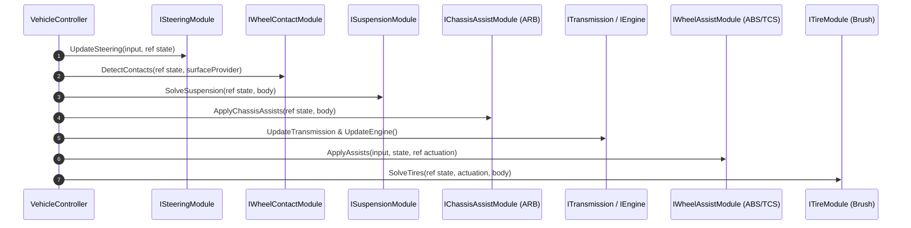

# System Architecture

VALYR is architected around the **Single Responsibility Principle** and strict separation between:
1. **Simulation State** (`VehicleState`, `WheelState`)
2. **Physics Adapters** (`IPhysicsBody`, `ISurfaceProvider`)
3. **Pluggable Subsystems** (`[SerializeReference] VehicleModule`)
4. **Visual Presentation & Audio/VFX** (`VehicleVisualView`)

---

## 1. State-Driven Pipeline

Unlike monolithic car controllers where physics, raycasts, and engine math are tightly coupled inside a single script, VALYR structures simulation as a deterministic pipeline of state transformations: `(VehicleInput, VehicleState) ➔ Subsystems ➔ (New VehicleState, Forces)`.



Because subsystems do not retain private physics state and instead read and write to `ref VehicleState`, the entire vehicle simulation can be rewound, rolled back, and re-simulated for networked client-side prediction without modifying a single line of physics code.

---

## 2. Core Subsystems

| Subsystem | Contract | Default Implementation | Responsibility |
|---|---|---|---|
| **Wheel Contact** | `IWheelContactModule` | `WheelContactModule` | Scans terrain geometry, curbs, ruts with multi-ray patches, and computes ground contact normals and damper clearance. |
| **Suspension** | `ISuspensionModule` | `RaycastSuspensionModule` | Solves equilibrium spring preload, asymmetric bump/rebound dampers, progressive bump stops, and applies upward load to chassis. |
| **Steering** | `ISteeringModule` | `DirectSteeringModule` | Speed-sensitive steering angle attenuation, Ackermann geometry, and steering response smoothing. |
| **Powertrain** | `IEngineModule` & `ITransmissionModule` | `ArcadeEngineModule`, `SimpleTransmissionModule` | Torque curves, flywheel inertia, rev limiter, clutch engagement, and automatic gear shifting. |
| **Tires** | `ITireModule` | `BrushTireModule` | Analytical brush tire friction model, combined longitudinal slip (sx) and lateral slip (sy), slip angles, and grip saturation. |
| **Assists** | `IChassisAssistModule`, `IWheelAssistModule` | `AntiRollBarModule`, `AbsModule`, `TcsModule` | Anti-roll lateral weight transfer, anti-lock braking pulsation, and traction control slip regulation. |

For instructions on writing your own modules, see the [Creating Custom Modules Guide](/guide/custom-modules).

---

## 3. Data Structures

* **`VehicleState`**:
  Stores vehicle-wide simulation data (Engine RPM, Current Gear, Clutch, Tick ID) and fixed 4-wheel data array `WheelData4<WheelState>`. It is a pure, unmanaged struct with zero heap allocations.
* **`WheelState`**:
  Stores single-wheel kinematics (`AngularVelocity`, `SteerAngle`, `RotationAngle`), contact data (`HasContact`, `ContactPoint`, `ContactNormal`, `SuspensionLength`, `SurfaceVelocity`), and dynamics (`NormalLoad`, `SlipRatio`, `SlipAngle`, `TireForce`, `SkidIntensity`).
* **`VehicleChassisConfig`**:
  Immutable geometric configuration passed down to modules containing curb mass, wheel rolling radii, and local wheel mount offsets.

---

## 4. Package Architecture & UPM Distribution

VALYR is organized into decoupled Unity Package Manager (UPM) packages:

* **Core Framework (`com.valyr.core`)**:
  Contains `VALYR.Core`, `VALYR.Modules`, `VALYR.Runtime`, and `VALYR.Editor`. Clean, self-contained vehicle simulation without external networking overhead.
  ```text
  https://github.com/l0nnes/VALYR.git#upm/core
  ```
* **Multiplayer Addon (`com.valyr.multiplayer`)**:
  Builds on top of Core using [PurrNet](https://purrnet.dev) & [PurrDiction](https://github.com/PurrNet/PurrDiction) in `VALYR.Multiplayer.asmdef`. Provides server-authoritative client-side prediction, rollback reconciliation, and networked vehicle synchronization.
  ```text
  https://github.com/l0nnes/VALYR.git#upm/multiplayer
  ```

For detailed multiplayer setup, see the [Multiplayer Addon Guide](/guide/multiplayer-addon).
