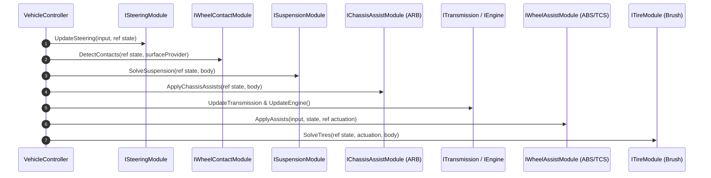

# System Architecture

VALYR is architected around the **Single Responsibility Principle** and strict separation between:
1. **Simulation State** (`VehicleState`, `WheelState`)
2. **Physics Adapters** (`IPhysicsBody`, `ISurfaceProvider`)
3. **Pluggable Subsystems** (`[SerializeReference] VehicleModule`)
4. **Visual Presentation & Audio/VFX** (`VehicleVisualView`)

---

## 1. Modular Subsystem Pipeline

Unlike monolithic car controllers where physics, raycasts, and engine math are mixed into a 3000-line script, VALYR breaks the vehicle down into interchangeable modules:

---

## 2. Core Subsystems

| Subsystem | Contract | Default Implementation | Responsibility |
|---|---|---|---|
| **Wheel Contact** | `IWheelContactModule` | `WheelContactModule` | Scans terrain geometry, curbs, ruts with multi-ray patches, and computes ground contact normals and damper clearance. |
| **Suspension** | `ISuspensionModule` | `RaycastSuspensionModule` | Solves equilibrium spring preload, asymmetric bump/rebound dampers, progressive bump stops, and applies upward $F_z$ load to chassis. |
| **Steering** | `ISteeringModule` | `DirectSteeringModule` | Speed-sensitive steering angle attenuation, Ackermann geometry, and steering response smoothing. |
| **Powertrain** | `IEngineModule` & `ITransmissionModule` | `ArcadeEngineModule`, `SimpleTransmissionModule` | Torque curves, flywheel inertia, rev limiter, clutch engagement, and automatic gear shifting. |
| **Tires** | `ITireModule` | `BrushTireModule` | Analytical brush tire friction model, combined longitudinal slip ($s_x$) and lateral slip ($s_y$), slip angles, and grip saturation. |
| **Assists** | `IChassisAssistModule`, `IWheelAssistModule` | `AntiRollBarModule`, `AbsModule`, `TcsModule` | Anti-roll lateral weight transfer, anti-lock braking pulsation, and traction control slip regulation. |

---

## 3. Data Structures

* **`VehicleState`**:
  Stores vehicle-wide data (Engine RPM, Current Gear, Clutch, Tick ID) and fixed 4-wheel data array `WheelData4<WheelState>`.
* **`WheelState`**:
  Stores single-wheel kinematics (`AngularVelocity`, `SteerAngle`, `RotationAngle`), contact data (`HasContact`, `ContactPoint`, `ContactNormal`, `SuspensionLength`, `SurfaceVelocity`), and dynamics (`NormalLoad`, `SlipRatio`, `SlipAngle`, `TireForce`, `SkidIntensity`).
* **`VehicleChassisConfig`**:
  Immutable geometric configuration passed down to modules containing curb mass, wheel rolling radii, and local wheel mount offsets.
