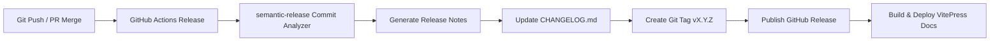

# Semantic Release & Contribution Guide

VALYR follows strict **Semantic Versioning** (`vMAJOR.MINOR.PATCH`) powered by automated GitHub Actions and [`semantic-release`](https://github.com/semantic-release/semantic-release).

---

## 1. Conventional Commits

All commit messages pushed to `main` or `master` must follow the [Conventional Commits](https://www.conventionalcommits.org/) specification:

```text
<type>(<scope>): <short description>

[optional body]

[optional footer(s)]
```

### Commit Types & Version Bumps

| Commit Prefix | SemVer Bump | Example | Release Notes |
|---|---|---|---|
| `fix:` | **PATCH** (`0.0.X`) | `fix(suspension): arrest bottoming velocity on bump stop` | Included in "Bug Fixes" |
| `feat:` | **MINOR** (`0.X.0`) | `feat(contact): add 5-point multi-ray curb detector` | Included in "Features" |
| `perf:` | **PATCH** (`0.0.X`) | `perf(rays): cache contact ray allocations` | Included in "Performance" |
| `docs:` | None (or patch) | `docs: add vitepress documentation site` | Included in "Documentation" |
| `refactor:` | None (or patch) | `refactor: decouple contact scanner from suspension` | Included in "Code Refactoring" |
| `BREAKING CHANGE:` | **MAJOR** (`X.0.0`) | `feat!: redesign ISuspensionModule signature` | Creates Major Release |

---

## 2. Automated Release Pipeline

When commits are merged into `master` / `main`:



1. **Commit Analyzer**: Inspects git history since last release tag.
2. **Release Notes Generator**: Compiles human-readable markdown changelog.
3. **Changelog**: Prepends changes into `CHANGELOG.md`.
4. **Git**: Bumps version in `package.json` and commits `[skip ci]`.
5. **GitHub**: Creates official GitHub Release and tags repository (`vX.Y.Z`).
6. **Deploy Pages**: Rebuilds VitePress docs site and updates GitHub Pages live.

---

## 3. Testing Documentation Locally

Run the local VitePress development server with live reload:

```bash
npm run docs:dev
```

To build and preview static output:

```bash
npm run docs:build
npm run docs:preview
```
